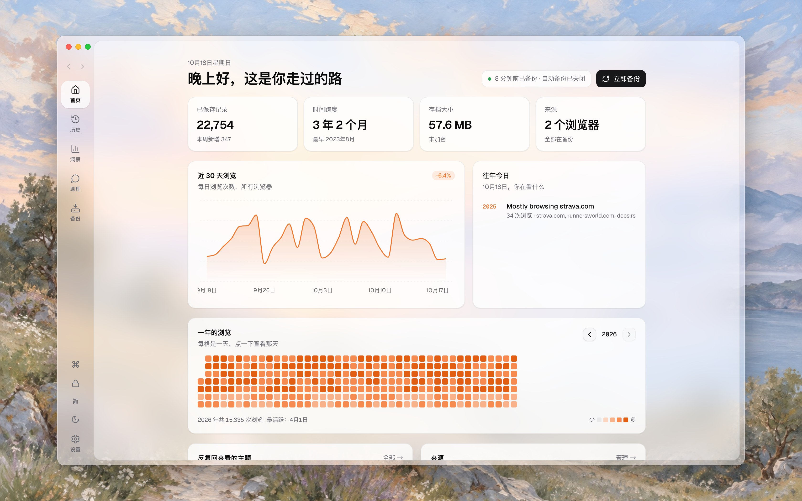
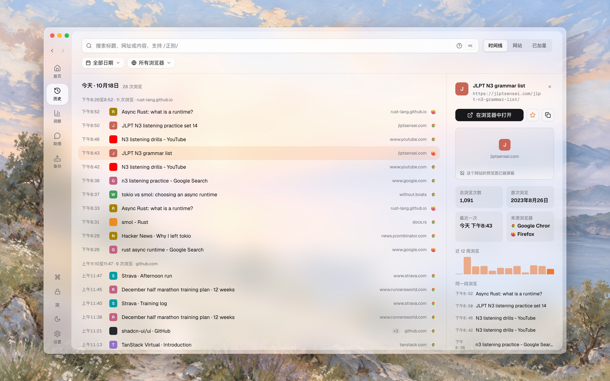
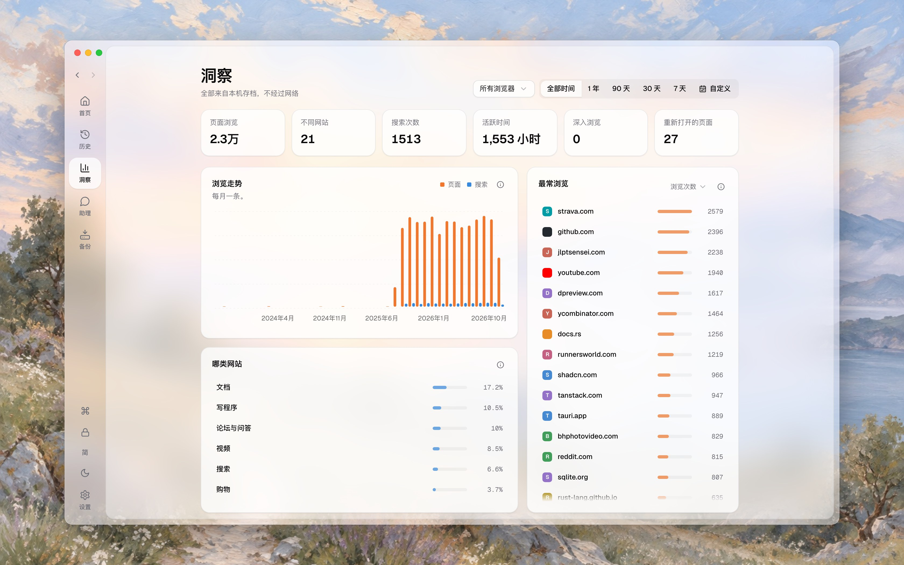
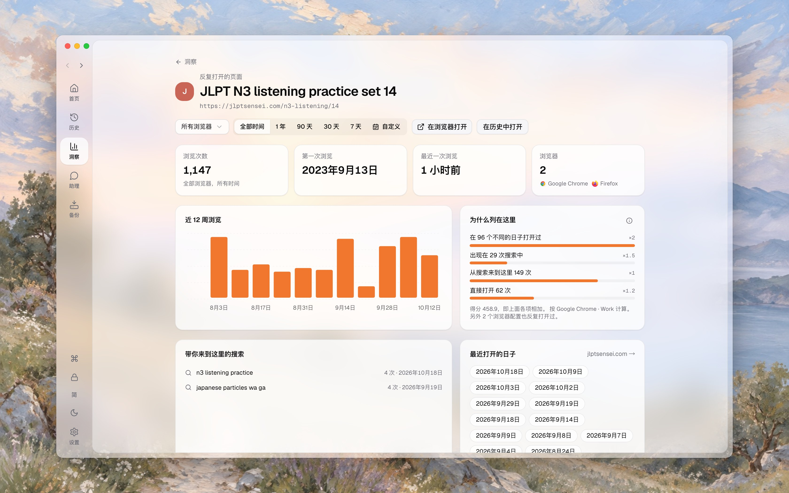
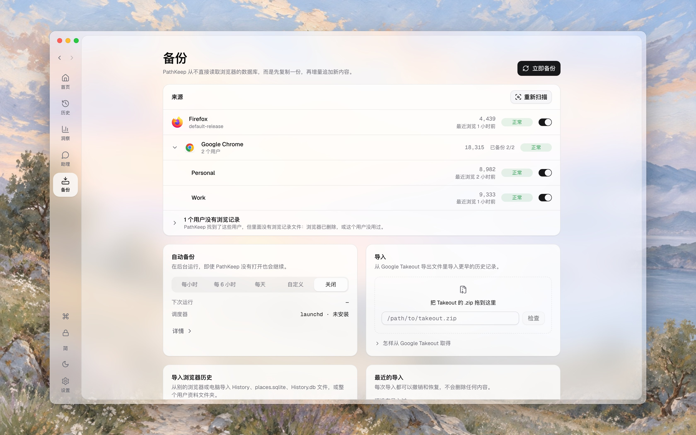
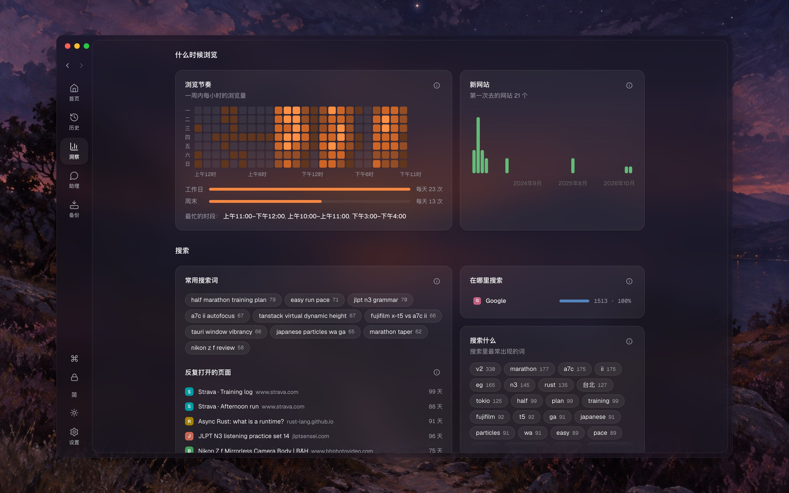
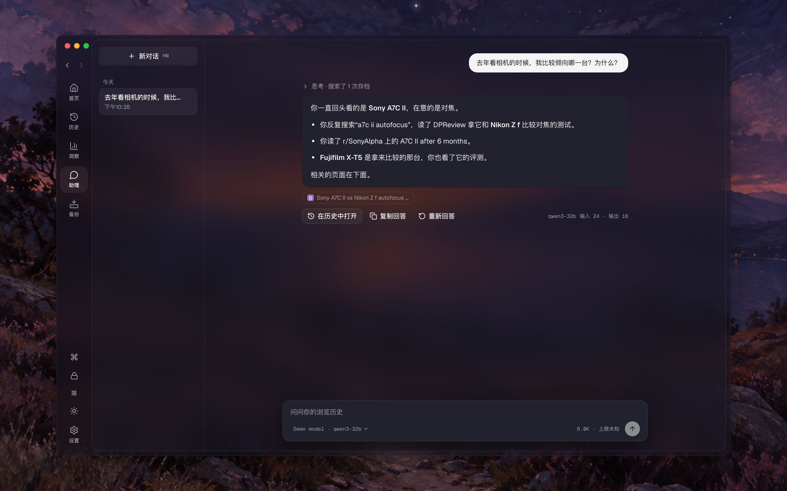
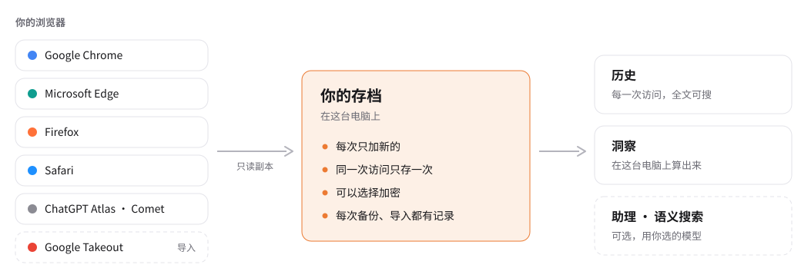

<div align="center">


# PathKeep

**留住你走过的路。**

浏览器会悄悄删掉你的历史记录。PathKeep 把它们全部留在你自己的电脑上，也帮你找回走过的路。

<a href="https://github.com/t41372/PathKeep/releases"></a>
<a href="https://github.com/t41372/PathKeep/actions/workflows/ci.yml"></a>
<a href="./LICENSE"></a>
<a href="https://tauri.app/"></a>
<a href="https://www.rust-lang.org/"></a>

中文 | [English](./README.md)

</div>

<picture>
  <source media="(prefers-color-scheme: dark)" srcset="docs/screenshots/zh-CN/home-dark.jpg" />
  
</picture>

PathKeep 是一个 macOS 和 Windows 上的桌面应用。它把你用的每个浏览器的历史，一点一点备份进你自己硬盘上的一份存档，想留多久就留多久。然后你可以在里面搜索全部记录，看看你的浏览习惯说明了什么；愿意的话，也可以直接用自然语言问它。

数据不上传任何服务器。AI 是可选的，你打开之前一直关着。

## 为什么

### 浏览器正在删你的历史

大多数人以为浏览历史一直都在，需要时随时能找到。**并不是。**

Chrome、Edge、Brave、Arc 等大多数 Chromium 浏览器，都沿用了上游的一个默认设置：**本地历史超过大约 90 天就删掉**。这不是 bug，而是[写在 Chromium 源码里](https://chromium.googlesource.com/chromium/src/+/master/components/history/core/browser/history_backend.cc)的。Safari [默认只留一年](https://support.apple.com/guide/safari/search-your-web-browsing-history-ibrw1114/mac)。Firefox 宽松一些，但也会[按数据库大小](https://searchfox.org/firefox-main/source/toolkit/components/places/PlacesExpiration.sys.mjs)清理。

同步也救不了它。同步是为了在几台设备之间用，不是为了保存。Firefox Sync 只上传[最近 30 天，并在 60 天后丢掉同步的历史](https://searchfox.org/firefox-main/source/services/sync/modules/constants.sys.mjs)。Brave Sync 只同步[你手动输入的网址](https://support.brave.com/hc/en-us/articles/360047642371-Sync-FAQ)。Arc [完全不同步历史](https://resources.arc.net/hc/en-us/articles/20272860828823-Arc-Sync)。

**如果你用 Chrome，又从没备份过历史，三个月前的记录多半已经没了。**

<details><summary><b>📋 各家浏览器到底会保留多久？（参考表格）</b></summary>

下表基于截至 2026 年 4 月的官方文档、帮助中心和源代码。"云同步"指各浏览器自家的同步服务。保留时长通常受用户设置影响，下面列出的是默认值。

| 浏览器               | 内核        | 本地默认                                                                                                                                      | 本地上限                                                                                                                                       | 云同步                                                                                                                                                                                  | 实际上限                     |
| -------------------- | ----------- | --------------------------------------------------------------------------------------------------------------------------------------------- | ---------------------------------------------------------------------------------------------------------------------------------------------- | --------------------------------------------------------------------------------------------------------------------------------------------------------------------------------------- | ---------------------------- |
| **Google Chrome**    | Chromium    | 约 3 个月（Chromium 默认）[\[1\]](https://chromium.googlesource.com/chromium/src/+/master/components/history/core/browser/history_backend.cc) | 未提供内置设置                                                                                                                                 | Google 账号可能根据"Web 与应用活动"保留更久 [\[2\]](https://support.google.com/chrome/answer/165139)                                                                                    | 本地约 3 个月；同步可能更久  |
| **Microsoft Edge**   | Chromium    | 约 3 个月（Chromium 默认）[\[1\]](https://chromium.googlesource.com/chromium/src/+/master/components/history/core/browser/history_backend.cc) | 企业策略只能进一步*缩短* [\[7\]](https://learn.microsoft.com/en-us/deployedge/microsoft-edge-browser-policies/browsingdatalifetime)            | 隐私面板保留部分同步数据，TTL 未公开 [\[5\]](https://support.microsoft.com/en-us/microsoft-edge/view-and-delete-browser-history-in-microsoft-edge-00cf7943-a9e1-975a-a33d-ac10ce454ca4) | 本地约 3 个月；云端 TTL 未知 |
| **Brave**            | Chromium    | 约 3 个月（Chromium 默认）[\[1\]](https://chromium.googlesource.com/chromium/src/+/master/components/history/core/browser/history_backend.cc) | 未找到永久保留设置                                                                                                                             | 仅同步手动输入的 URL；12 个月未活动后服务器删除 [\[8\]](https://support.brave.com/hc/en-us/articles/360047642371-Sync-FAQ)                                                              | 本地约 3 个月                |
| **Arc**              | Chromium    | 约 3 个月（Chromium 默认）[\[1\]](https://chromium.googlesource.com/chromium/src/+/master/components/history/core/browser/history_backend.cc) | 未找到永久保留设置                                                                                                                             | **不同步历史** [\[12\]](https://resources.arc.net/hc/en-us/articles/20272860828823-Arc-Sync)                                                                                            | 本地约 3 个月                |
| **Opera / Opera GX** | Chromium    | 约 3 个月（Chromium 默认）[\[1\]](https://chromium.googlesource.com/chromium/src/+/master/components/history/core/browser/history_backend.cc) | 未找到永久保留设置                                                                                                                             | 同步历史，但云端 TTL 未公开 [\[17\]](https://help.opera.com/en/latest/features/#sync)                                                                                                   | 本地约 3 个月                |
| **Vivaldi**          | Chromium    | 3 个月 [\[9\]](https://help.vivaldi.com/desktop/navigation/history/)                                                                          | **永久**（用户可设置）[\[9\]](https://help.vivaldi.com/desktop/navigation/history/)                                                            | 同步历史，但云端 TTL 未公开 [\[10\]](https://help.vivaldi.com/desktop/tools/sync/)                                                                                                      | 永久（取决于配置）           |
| **Dia**              | Chromium 系 | 未披露（大概约 3 个月）                                                                                                                       | 未找到永久保留设置                                                                                                                             | 提供端到端加密同步，但未公开历史 TTL [\[28\]](https://diabrowser.com/privacy)                                                                                                           | 未披露                       |
| **Safari**           | WebKit      | 1 年（默认）[\[14\]](https://support.apple.com/guide/safari/search-your-web-browsing-history-ibrw1114/mac)                                    | 可配置（未找到硬上限）                                                                                                                         | iCloud 跨设备同步，云端 TTL 未公开 [\[15\]](https://support.apple.com/guide/icloud/what-you-can-do-with-icloud-and-safari-mm9b8da4f328/icloud)                                          | 可配置                       |
| **Firefox**          | Gecko       | 按容量回收（无固定天数）[\[18\]](https://searchfox.org/firefox-main/source/toolkit/components/places/PlacesExpiration.sys.mjs)                | 可通过 `max_pages` 配置，可保留**数年** [\[18\]](https://searchfox.org/firefox-main/source/toolkit/components/places/PlacesExpiration.sys.mjs) | 仅上传最近 30 天，云端 60 天后过期 [\[19\]](https://searchfox.org/firefox-main/source/services/sync/modules/constants.sys.mjs)                                                          | 本地数年；Sync 约 60 天      |
| **LibreWolf**        | Firefox 系  | 类似 Firefox（除非开启"关闭即清空"）[\[21\]](https://librewolf.net/docs/faq/)                                                                 | 与 Firefox 相同 [\[18\]](https://searchfox.org/firefox-main/source/toolkit/components/places/PlacesExpiration.sys.mjs)                         | 可手动接入 Firefox Sync [\[21\]](https://librewolf.net/docs/faq/)                                                                                                                       | 类似 Firefox                 |
| **Floorp**           | Firefox 系  | 推测类似 Firefox                                                                                                                              | 未公开                                                                                                                                         | 未公开                                                                                                                                                                                  | 推测类似 Firefox             |
| **Waterfox**         | Firefox 系  | 推测类似 Firefox                                                                                                                              | 未公开                                                                                                                                         | 未公开                                                                                                                                                                                  | 推测类似 Firefox             |
| **Zen Browser**      | Firefox 系  | 推测类似 Firefox                                                                                                                              | 未公开                                                                                                                                         | 历史走 Firefox Sync，Window Sync 仅本地 [\[27\]](https://docs.zen-browser.app/user-manual/window-sync)                                                                                  | 本地推测类似 Firefox         |
| **ChatGPT Atlas**    | Chromium    | 未披露（大概约 3 个月）                                                                                                                       | 未披露                                                                                                                                         | 提供 Web History 控制项，云端 TTL 未公开 [\[30\]](https://help.openai.com/en/articles/12625059-web-browsing-settings-on-chatgpt-atlas)                                                  | 未披露                       |
| **Perplexity Comet** | Chromium 系 | 本地保存历史，TTL 未公开                                                                                                                      | 未披露                                                                                                                                         | 历史走端到端加密同步，云端 TTL 未公开 [\[32\]](https://comet-help.perplexity.ai/en/articles/12658050-log-in-to-perplexity)                                                              | 未披露                       |

**一句话总结：** 除非你用的是 Firefox（按容量回收），或者手动调过 Safari、Vivaldi 这种浏览器，否则你的浏览器几乎一定在按一个你从未同意过的时间表删除历史。

_注：约 3 个月的 Chromium 上限是基于上游 Chromium 源码推断出来的。下游浏览器有权修改这个行为，但绝大多数并未公开声明不同的保留策略。_

</details>

### 它值得留下来

浏览历史记录了你怎么学会一件事，做重大决定前查过什么，人生发生变化的那一周在读什么。对大多数人来说，它最接近一本记录网上时光的日记，而浏览器按一个没人同意过的时间表把它丢掉。

以前这不太要紧，因为几百万条原始网址摆在那里，谁也看不出什么。现在不一样了：在你自己电脑上跑的模型，已经能读完几年的浏览记录，告诉你那段时间在忙什么。今天留下的数据，就是以后能问的东西；已经没了的，就问不了了。

## 它能做什么

- **备份每一个浏览器。** PathKeep 找到你的浏览器和它们的用户资料，把历史复制进一份存档。每次只加新的，同一次访问只存一次，即使两个来源都有它。自动备份在后台运行，PathKeep 关着也照样跑。
- **找回更早的历史。** 导入 Google Takeout 里的 Chrome 历史（通常约 18 个月，取决于你的 Google 账号设置），或另一个浏览器、另一台电脑的历史文件。每次导入都可以撤销。
- **历史。** 每一次访问，按天、按浏览片段排开，几百万条也一样流畅。可以搜标题、网址和页面内容，也可以用正则表达式。按日期、浏览器和网站筛选，给页面加星标，写下以后能搜到的笔记。全部导出成 HTML、Markdown、纯文本或 JSON Lines。
- **洞察。** 在你的电脑上从存档算出来，看全部时间或任意一段：最常去的网站和它们属于哪一类，你什么时候上网，搜什么、搜索怎么收尾，反复打开的页面，在网站之间怎么走。大多数卡片都能点进去看背后的记录。
- **助理**（可选）。用自然语言问你的历史，用你电脑上的模型（LM Studio、Ollama），或你设置的服务（OpenAI 或兼容服务、Anthropic、Gemini）。它会搜索你的存档，并列出它用到的页面。
- **语义搜索**（可选）。按页面讲的是什么来找，不只是按字面。索引在你的电脑上建，用 PathKeep 下载一次的小模型，或你选的服务里的模型。
- **归你所有。** 存档可以用密码加密。每次备份和导入都留下一份看得懂的记录。PathKeep 从不写入浏览器自己的文件。

<table>
  <tr>
    <td width="50%" valign="top">
      <a href="docs/screenshots/zh-CN/history.jpg"></a>
      <br><b>历史</b> · 每一次访问按天、按片段排开。打开一条，看你去过几次、那时还读了什么。
    </td>
    <td width="50%" valign="top">
      <a href="docs/screenshots/zh-CN/insights.jpg"></a>
      <br><b>洞察</b> · 默认看全部时间，也可以选任意一段、某一个浏览器。
    </td>
  </tr>
  <tr>
    <td width="50%" valign="top">
      <a href="docs/screenshots/zh-CN/page.jpg"></a>
      <br><b>反复打开的页面</b> · 洞察为什么列出它，以及把你带到这里的搜索。
    </td>
    <td width="50%" valign="top">
      <a href="docs/screenshots/zh-CN/backup.jpg"></a>
      <br><b>备份</b> · 每个浏览器和用户资料、自动备份，以及导入。
    </td>
  </tr>
  <tr>
    <td width="50%" valign="top">
      <a href="docs/screenshots/zh-CN/rhythm.jpg"></a>
      <br><b>什么时候浏览</b> · 一周里每个小时的浏览，以及你搜什么。深色模式。
    </td>
    <td width="50%" valign="top">
      <a href="docs/screenshots/zh-CN/ask.jpg"></a>
      <br><b>助理</b> · 它搜索你的存档，带着找到的页面回答。深色模式。
    </td>
  </tr>
</table>

界面有英文、简体中文和繁体中文，有浅色和深色两种外观。图里是演示存档（`bun run dev:demo`）的虚构浏览记录，不是任何人自己的；助理那张图里模型的话是写好的。

## 怎么运作

<picture>
  <source media="(prefers-color-scheme: dark)" srcset="docs/screenshots/zh-CN/how-it-works-dark.svg" />
  
</picture>

- PathKeep 从不打开浏览器正在用的数据库。它先复制文件，再读副本，所以浏览器照常运行，它的文件也从不被改动。
- 存档保存每一次访问的时间、标题、浏览器和用户资料。已经有的访问不会再加一次，所以常备份也不费事。
- 历史、洞察和助理都从存档读取，而不是从浏览器，所以浏览器删掉的，它们还在。
- 它的设计目标是 4 核、8 GB 内存的电脑上 1440 万条访问的存档。

## 安装

从 [GitHub Releases](https://github.com/t41372/PathKeep/releases) 下载最新版本。

- **macOS。** 打开 `.dmg`，把 PathKeep 拖进“应用程序”。应用还没有 Apple 签名，所以第一次打开前要去掉隔离标记（`xattr -dr com.apple.quarantine /Applications/PathKeep.app`），或者右键点它选“打开”。步骤和校验值在版本说明里。要备份 Safari，在 PathKeep 请求时给它“完全磁盘访问权限”。
- **Windows。** 运行 `.msi` 或 `-setup.exe`。还没有签名，所以 Windows 会显示“未知发布者”，SmartScreen 可能要你选“更多信息 → 仍要运行”。缺少 WebView2 时，安装程序会下载它。
- **Linux。** 支持还在路上。每个版本都附有安装包（`.AppImage`、`.deb`、`.rpm`）可以试用，但还没在真实桌面上测过。自动备份需要你自己打开 PathKeep 写好的 systemd 计时器。

如果存档加了密又想自动备份，让 PathKeep 把密码存进系统钥匙串，后台备份才打得开存档。

### 从 0.3 升级

第一次打开时，PathKeep 会把存档转成新格式。开始前，它先告诉你要多少空闲空间（大约是存档的三倍）、会动到哪些文件。新存档和旧文件核对过之前，旧文件原样留着；升级中断了，下次从停下的地方接着做。如果开着 App Lock，先用 0.3 的密码解锁。

### 卸载

1. 把 **备份 → 自动备份** 设成 **关闭**，这会移除定时任务。只删掉应用不会。
2. 退出 PathKeep，删除应用，或用系统卸载它。
3. 如果连存档也不要了：删除 PathKeep 的数据文件夹（macOS 上是 `~/Library/Application Support/com.yi-ting.pathkeep`）。

## 浏览器

| 状态   | 浏览器                                                                                                                    |
| ------ | ------------------------------------------------------------------------------------------------------------------------- |
| 已测试 | Google Chrome、Microsoft Edge（含 Edge Dev）、Firefox、Safari（macOS）、ChatGPT Atlas（macOS）、Perplexity Comet（macOS） |
| 已实现 | Chromium、Brave、Vivaldi、Arc、Opera、Opera GX、LibreWolf、Floorp、Waterfox：能找到并备份，但还没为正式版本测过           |

浏览器怎么从“已实现”变成“已测试”：[adapter playbook](./docs/architecture/browser-support-and-adapter-playbook.md)。

## 隐私

- 你的历史留在你的电脑上。没有账号，也没有服务器。
- 有两个功能会联系网站：链接预览（页面提供的图片）和页面摘要。设置 → 通用里能看到这两项，都可以关掉。
- 用应用内模型打开语义搜索时，会下载一次那个模型。
- AI 在你打开之前一直关着。用你电脑上的模型时，什么都不会离开电脑。用你设置的服务时，助理会把你的问题和回答需要的搜索结果发给那个服务，语义搜索会把要建索引的页面发给它。
- MCP 服务器让你电脑上的其他应用只读地搜索你的历史。它默认关闭，设置 → AI 里会列出它们读了什么。

## 从源码构建

需要 [Bun](https://bun.sh)、Rust 1.96（`rust-toolchain.toml` 会自动选它）、Git，以及你的系统上的 [Tauri 前置依赖](https://v2.tauri.app/start/prerequisites/)。Debian 或 Ubuntu 上：

```bash
sudo apt-get install -y pkg-config libglib2.0-dev libgtk-3-dev \
  libwebkit2gtk-4.1-dev libayatana-appindicator3-dev librsvg2-dev patchelf rpm
```

```bash
bun install
bun run desktop:dev       # 桌面应用，读你自己的浏览器
bun run dev:demo          # 真实应用配虚构浏览器，打开 http://127.0.0.1:1420
bun run desktop:build     # 正式版本构建
bun run check             # 完整检查：lint、构建、Rust 检查和全部 E2E 测试
```

README 里的图由 `node scripts/readme-screenshots.mjs` 生成（同时开着 `bun run dev:demo -- --fresh`），示意图由 `node scripts/readme-diagram.mjs` 生成。

## 文档

| 你要找的               | 在哪里                                                                                                                   |
| ---------------------- | ------------------------------------------------------------------------------------------------------------------------ |
| 怎么参与贡献           | [CONTRIBUTING.md](./CONTRIBUTING.md)                                                                                     |
| 搭环境、认识代码结构   | [DEVELOPMENT.md](./DEVELOPMENT.md)                                                                                       |
| 测试和检查跑了什么     | [TESTING.md](./TESTING.md)                                                                                               |
| 发布                   | [RELEASE.md](./RELEASE.md)                                                                                               |
| 出问题时               | [TROUBLESHOOTING.md](./TROUBLESHOOTING.md)、[SUPPORT.md](./SUPPORT.md)                                                   |
| 浏览器支持             | [docs/architecture/browser-support-and-adapter-playbook.md](./docs/architecture/browser-support-and-adapter-playbook.md) |
| 产品、功能、设计、决策 | [docs/](./docs/)                                                                                                         |

## 许可证

[GNU General Public License v3.0](./LICENSE)
