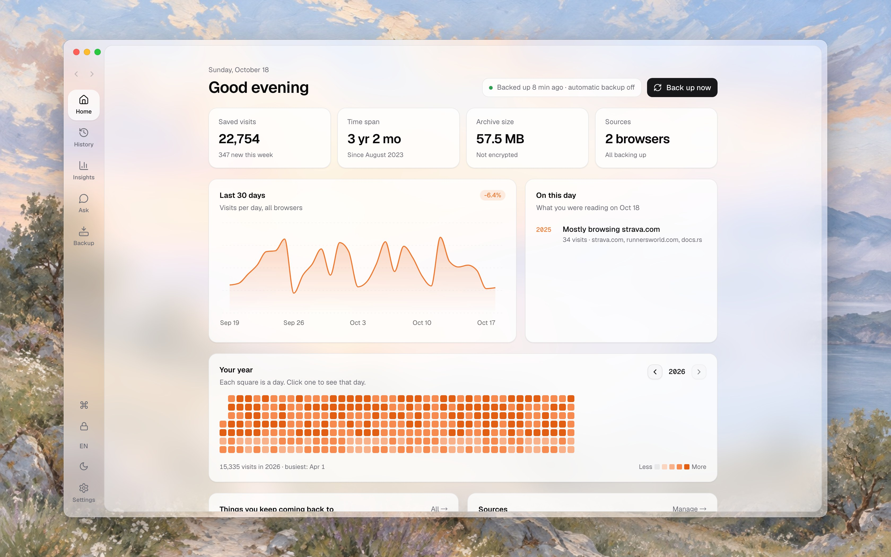
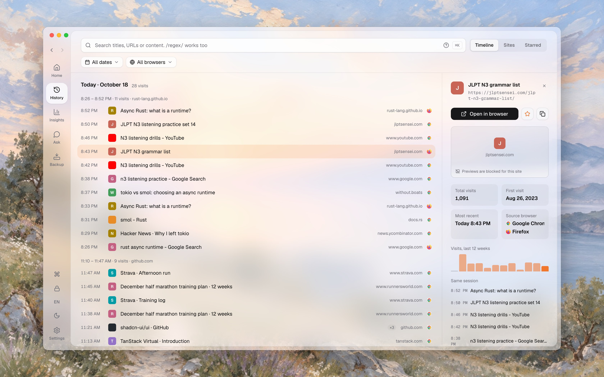
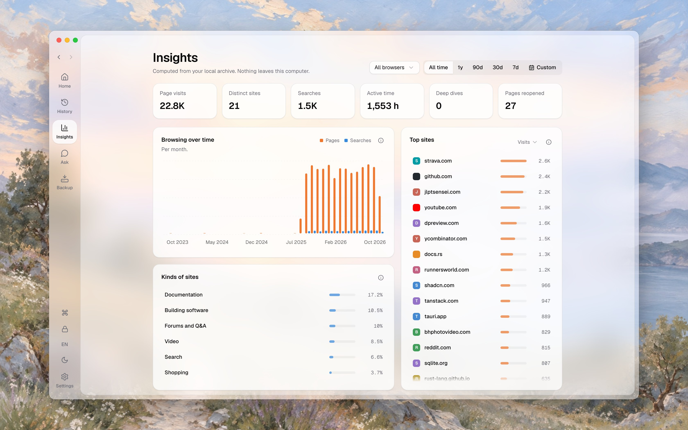
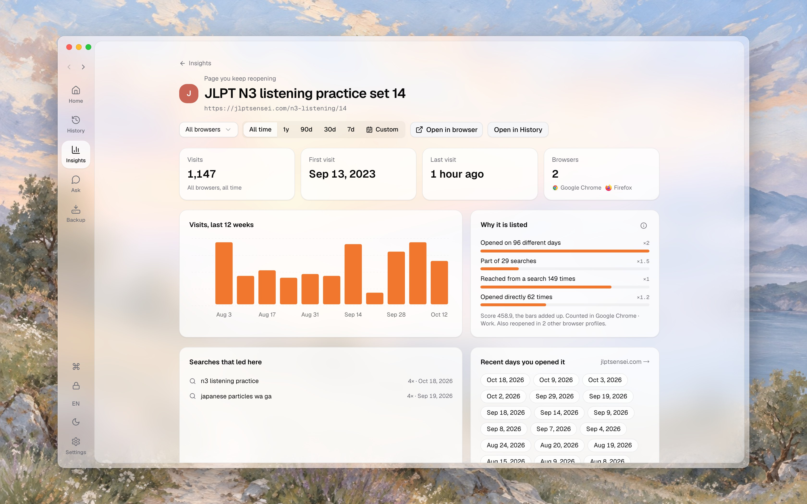
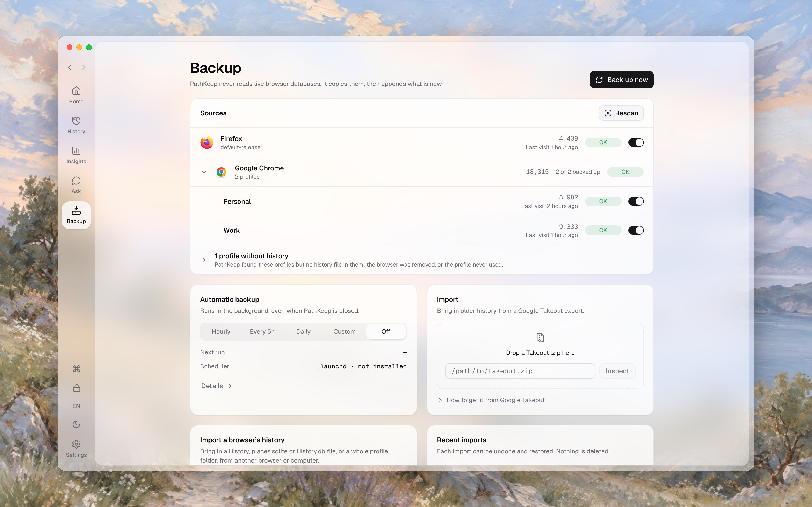
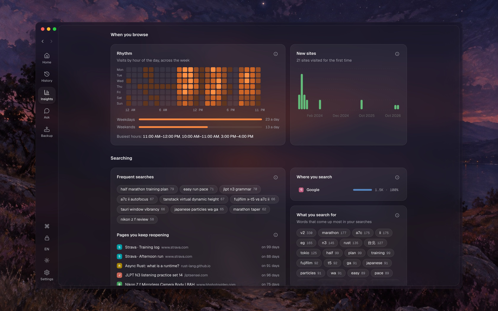
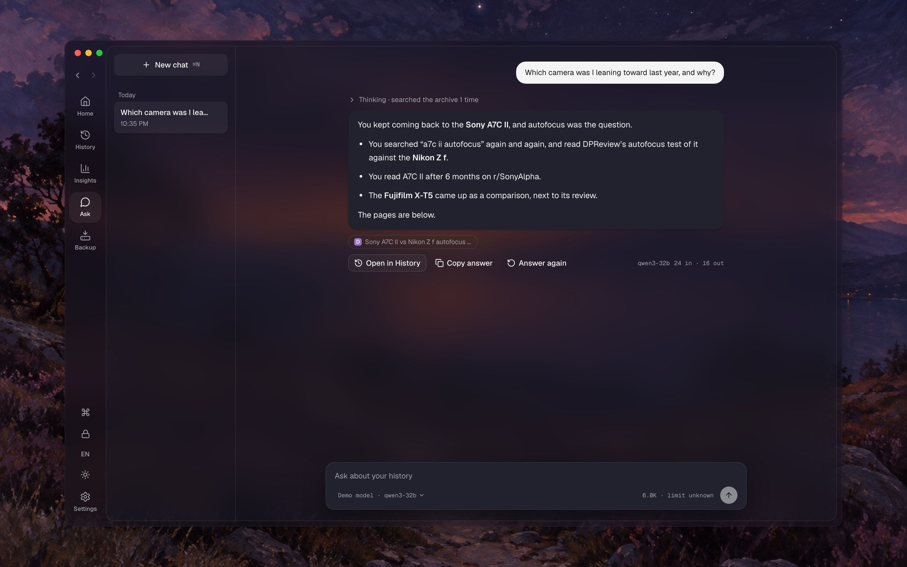
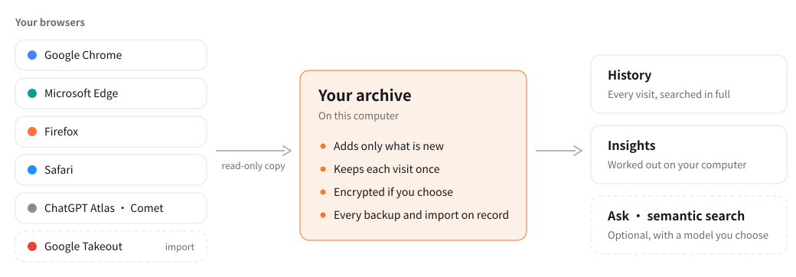

<div align="center">


# PathKeep

**Keep the path you've walked.**

Your browsers quietly delete your history. PathKeep keeps all of it, on your computer, and helps you find your way back.

<a href="https://github.com/t41372/PathKeep/releases"></a>
<a href="https://github.com/t41372/PathKeep/actions/workflows/ci.yml"></a>
<a href="./LICENSE"></a>
<a href="https://tauri.app/"></a>
<a href="https://www.rust-lang.org/"></a>

[中文](./README.CN.md) | English

</div>

<picture>
  <source media="(prefers-color-scheme: dark)" srcset="docs/screenshots/en/home-dark.jpg" />
  
</picture>

PathKeep is a desktop app for macOS and Windows. It backs up the history of every browser you use into one archive on your own disk, a little at a time, for as long as you want to keep it. Then it lets you search all of it, see what your browsing says about you, and, if you want, ask about it in plain words.

Nothing goes to a server. AI is optional and off until you turn it on.

## Why

### Your browser is deleting your history

Most people assume their browsing history is there when they need it. **It isn't.**

Chrome, Edge, Brave, Arc and most other Chromium browsers inherit an upstream default that **deletes local history older than about 90 days**. It's [in the Chromium source](https://chromium.googlesource.com/chromium/src/+/master/components/history/core/browser/history_backend.cc), not a bug. Safari keeps [one year by default](https://support.apple.com/guide/safari/search-your-web-browsing-history-ibrw1114/mac). Firefox is more generous, but it still prunes history [by database size](https://searchfox.org/firefox-main/source/toolkit/components/places/PlacesExpiration.sys.mjs).

Sync doesn't save it either. Sync is for using several devices, not for keeping things. Firefox Sync uploads only the [last 30 days and drops synced history after 60](https://searchfox.org/firefox-main/source/services/sync/modules/constants.sys.mjs). Brave Sync covers only [URLs you typed](https://support.brave.com/hc/en-us/articles/360047642371-Sync-FAQ). Arc [doesn't sync history at all](https://resources.arc.net/hc/en-us/articles/20272860828823-Arc-Sync).

**If you use Chrome and have never backed up your history, everything older than three months is most likely already gone.**

<details><summary><b>📋 How long does your browser actually keep history? (reference table)</b></summary>

Data sourced from official documentation, help centers, and source code as of April 2026. "Cloud sync" refers to the browser's first-party sync service. Retention often depends on user settings; defaults are shown below.

| Browser              | Engine         | Local Default                                                                                                                                  | Local Max                                                                                                                                               | Cloud Sync                                                                                                                                                                                                    | Effective Max                        |
| -------------------- | -------------- | ---------------------------------------------------------------------------------------------------------------------------------------------- | ------------------------------------------------------------------------------------------------------------------------------------------------------- | ------------------------------------------------------------------------------------------------------------------------------------------------------------------------------------------------------------- | ------------------------------------ |
| **Google Chrome**    | Chromium       | ~3 months (Chromium default) [[1]](https://chromium.googlesource.com/chromium/src/+/master/components/history/core/browser/history_backend.cc) | No built-in setting found                                                                                                                               | Google Account may retain longer depending on Web & App Activity settings [[2]](https://support.google.com/chrome/answer/165139)                                                                              | ~3 months locally; longer if synced  |
| **Microsoft Edge**   | Chromium       | ~3 months (Chromium default) [[1]](https://chromium.googlesource.com/chromium/src/+/master/components/history/core/browser/history_backend.cc) | Enterprise policy can _shorten_ only [[7]](https://learn.microsoft.com/en-us/deployedge/microsoft-edge-browser-policies/browsingdatalifetime)           | Privacy dashboard retains some synced data; TTL undocumented [[5]](https://support.microsoft.com/en-us/microsoft-edge/view-and-delete-browser-history-in-microsoft-edge-00cf7943-a9e1-975a-a33d-ac10ce454ca4) | ~3 months locally; cloud TTL unknown |
| **Brave**            | Chromium       | ~3 months (Chromium default) [[1]](https://chromium.googlesource.com/chromium/src/+/master/components/history/core/browser/history_backend.cc) | No keep-forever setting found                                                                                                                           | Only typed URLs; server deletes after 12 months inactive [[8]](https://support.brave.com/hc/en-us/articles/360047642371-Sync-FAQ)                                                                             | ~3 months locally                    |
| **Arc**              | Chromium       | ~3 months (Chromium default) [[1]](https://chromium.googlesource.com/chromium/src/+/master/components/history/core/browser/history_backend.cc) | No keep-forever setting found                                                                                                                           | **Does not sync history** [[12]](https://resources.arc.net/hc/en-us/articles/20272860828823-Arc-Sync)                                                                                                         | ~3 months locally                    |
| **Opera / Opera GX** | Chromium       | ~3 months (Chromium default) [[1]](https://chromium.googlesource.com/chromium/src/+/master/components/history/core/browser/history_backend.cc) | No keep-forever setting found                                                                                                                           | Syncs history, but cloud TTL is undocumented [[17]](https://help.opera.com/en/latest/features/#sync)                                                                                                          | ~3 months locally                    |
| **Vivaldi**          | Chromium       | 3 months [[9]](https://help.vivaldi.com/desktop/navigation/history/)                                                                           | **Forever** (user setting) [[9]](https://help.vivaldi.com/desktop/navigation/history/)                                                                  | Syncs history, but cloud TTL is undocumented [[10]](https://help.vivaldi.com/desktop/tools/sync/)                                                                                                             | Forever (if configured)              |
| **Dia**              | Chromium-based | Undisclosed (likely ~3 months)                                                                                                                 | No keep-forever setting found                                                                                                                           | E2E encrypted sync exists, but no published history TTL [[28]](https://diabrowser.com/privacy)                                                                                                                | Undisclosed                          |
| **Safari**           | WebKit         | 1 year (default) [[14]](https://support.apple.com/guide/safari/search-your-web-browsing-history-ibrw1114/mac)                                  | Configurable (no hard cap found)                                                                                                                        | iCloud syncs history across devices; cloud TTL undocumented [[15]](https://support.apple.com/guide/icloud/what-you-can-do-with-icloud-and-safari-mm9b8da4f328/icloud)                                         | Configurable                         |
| **Firefox**          | Gecko          | Capacity-driven (no fixed day limit) [[18]](https://searchfox.org/firefox-main/source/toolkit/components/places/PlacesExpiration.sys.mjs)      | Configurable via `max_pages`; can retain **years** [[18]](https://searchfox.org/firefox-main/source/toolkit/components/places/PlacesExpiration.sys.mjs) | Only last 30 days uploaded; expires after 60 days in cloud [[19]](https://searchfox.org/firefox-main/source/services/sync/modules/constants.sys.mjs)                                                          | Years locally; ~60 days via Sync     |
| **LibreWolf**        | Firefox-based  | Firefox-like (unless clear-on-close is on) [[21]](https://librewolf.net/docs/faq/)                                                             | Same as Firefox [[18]](https://searchfox.org/firefox-main/source/toolkit/components/places/PlacesExpiration.sys.mjs)                                    | Firefox Sync available manually [[21]](https://librewolf.net/docs/faq/)                                                                                                                                       | Firefox-like                         |
| **Floorp**           | Firefox-based  | Likely Firefox-like                                                                                                                            | Not documented                                                                                                                                          | Not documented                                                                                                                                                                                                | Likely Firefox-like                  |
| **Waterfox**         | Firefox-based  | Likely Firefox-like                                                                                                                            | Not documented                                                                                                                                          | Not documented                                                                                                                                                                                                | Likely Firefox-like                  |
| **Zen Browser**      | Firefox-based  | Likely Firefox-like                                                                                                                            | Not documented                                                                                                                                          | Supports Firefox Sync for history; Window Sync is local only [[27]](https://docs.zen-browser.app/user-manual/window-sync)                                                                                     | Likely Firefox-like locally          |
| **ChatGPT Atlas**    | Chromium       | Undisclosed (likely ~3 months)                                                                                                                 | Undisclosed                                                                                                                                             | Web History controls exist; cloud TTL undocumented [[30]](https://help.openai.com/en/articles/12625059-web-browsing-settings-on-chatgpt-atlas)                                                                | Undisclosed                          |
| **Perplexity Comet** | Chromium-based | Local history stored; TTL undocumented                                                                                                         | Undisclosed                                                                                                                                             | E2E encrypted sync for history; cloud TTL undocumented [[32]](https://comet-help.perplexity.ai/en/articles/12658050-log-in-to-perplexity)                                                                     | Undisclosed                          |

**Key takeaway:** Unless you use Firefox (capacity-driven) or have manually configured browsers like Safari or Vivaldi, your browser is almost certainly deleting history on a schedule you never agreed to.

_Note: The ~3 month Chromium limit is inferred from the upstream Chromium source code. While downstream browsers can alter this, most do not document a different retention policy._

</details>

### It's worth keeping

Browser history is a record of how you learned things, how you researched a big decision, and what you were reading the week something changed. It's the closest thing most of us have to a diary of the time we spend online, and the browser throws it away on a schedule nobody agreed to.

For years that didn't matter much, because nobody could get anything out of millions of raw URLs. That has changed. A model running on your own computer can now read through years of browsing and tell you what was going on. The data you keep today is what you'll be able to ask about later, and you can't ask about what's already gone.

## What it does

- **Backs up every browser.** PathKeep finds your browsers and their profiles, and copies their history into one archive. Each run adds only what's new and keeps each visit once, even when two sources have it. Automatic backups run in the background, also when PathKeep is closed.
- **Brings back older history.** Import Google Takeout's Chrome history (often around 18 months, depending on your Google account), or a history file from another browser or another computer. Every import can be undone.
- **History.** Every visit, by day and by session, in a list that stays fast with millions of them. Search titles, addresses and page content, or use a regular expression. Filter by date, browser and site, star pages, and write notes you can search later. Export it all to HTML, Markdown, plain text or JSON Lines.
- **Insights.** Worked out on your computer from your archive, over all time or any range: your top sites and what kind they are, when you browse, what you search for and how those searches go, the pages you keep reopening, and how you move between sites. Most cards open to what's behind them.
- **Ask** (optional). Ask about your history in plain words, with a model on your computer (LM Studio, Ollama) or a service you set up (OpenAI or compatible, Anthropic, Gemini). It searches your archive and shows the pages it used.
- **Semantic search** (optional). Find pages by what they're about, not only by their words. The index is built on your computer, with a small model PathKeep downloads once, or with a model from a service you choose.
- **Yours.** The archive can be encrypted with a password. Every backup and import leaves a record you can read. PathKeep never writes to your browsers' files.

<table>
  <tr>
    <td width="50%" valign="top">
      <a href="docs/screenshots/en/history.jpg"></a>
      <br><b>History</b> · every visit by day and session. Open one to see how often you've been there and what else you read then.
    </td>
    <td width="50%" valign="top">
      <a href="docs/screenshots/en/insights.jpg"></a>
      <br><b>Insights</b> · all time by default, or any range, in one browser or all of them.
    </td>
  </tr>
  <tr>
    <td width="50%" valign="top">
      <a href="docs/screenshots/en/page.jpg"></a>
      <br><b>A page you keep reopening</b> · why Insights lists it, and the searches that led there.
    </td>
    <td width="50%" valign="top">
      <a href="docs/screenshots/en/backup.jpg"></a>
      <br><b>Backup</b> · each browser and profile, automatic backups, and imports.
    </td>
  </tr>
  <tr>
    <td width="50%" valign="top">
      <a href="docs/screenshots/en/rhythm.jpg"></a>
      <br><b>When you browse</b> · your week by the hour, and what you search for. In the dark theme.
    </td>
    <td width="50%" valign="top">
      <a href="docs/screenshots/en/ask.jpg"></a>
      <br><b>Ask</b> · it searches your archive and answers with the pages it found. In the dark theme.
    </td>
  </tr>
</table>

The app is in English, Simplified Chinese and Traditional Chinese, in a light and a dark theme. The pictures are from the demo archive (`bun run dev:demo`), made-up browsing rather than anyone's own; in the Ask picture the model's words are scripted.

## How it works

<picture>
  <source media="(prefers-color-scheme: dark)" srcset="docs/screenshots/en/how-it-works-dark.svg" />
  
</picture>

- PathKeep never opens a browser's live database. It copies the file first and reads the copy, so the browser keeps running and its files are never changed.
- The archive holds every visit with its time, title, browser and profile. A visit that's already there isn't added again, so backing up often costs little.
- History, Insights and Ask read from the archive, not from the browsers, so they still have what the browsers have since deleted.
- It's designed for archives of 14.4 million visits on a 4-core computer with 8 GB of memory.

## Install

Download the latest release from [GitHub Releases](https://github.com/t41372/PathKeep/releases).

- **macOS.** Open the `.dmg` and drag PathKeep to Applications. The app isn't signed by Apple yet, so the first time, remove the quarantine flag (`xattr -dr com.apple.quarantine /Applications/PathKeep.app`) or right-click it and choose Open. The release notes have the steps and checksums. To back up Safari, give PathKeep Full Disk Access when it asks.
- **Windows.** Run the `.msi` or `-setup.exe`. It isn't signed yet, so Windows shows `Unknown Publisher` and SmartScreen may ask you to choose **More info → Run anyway**. If WebView2 is missing, the installer downloads it.
- **Linux.** Support is on the way. Packages (`.AppImage`, `.deb`, `.rpm`) are attached to each release for trying it out, but Linux hasn't been tested on real desktops yet. Automatic backups need you to turn on the systemd timer PathKeep writes.

If your archive is encrypted and you want automatic backups, let PathKeep keep the password in your system's keychain, so the background backup can open the archive.

### Upgrading from 0.3

On first launch, PathKeep moves your archive to its new format. It first shows how much free space it needs (about three times the archive's size) and which files it touches. The old files stay where they are until the new archive has been checked against them, and an interrupted upgrade carries on where it stopped. If App Lock is on, unlock with your 0.3 passcode first.

### Uninstall

1. Set **Backup → Automatic backup** to **Off**, which removes the scheduled job. Deleting the app doesn't.
2. Quit PathKeep and delete the app, or uninstall it with your system.
3. Only if you also want your archive gone: delete PathKeep's data folder (on macOS, `~/Library/Application Support/com.yi-ting.pathkeep`).

## Browsers

| Status      | Browsers                                                                                                                       |
| ----------- | ------------------------------------------------------------------------------------------------------------------------------ |
| Tested      | Google Chrome, Microsoft Edge (and Edge Dev), Firefox, Safari (macOS), ChatGPT Atlas (macOS), Perplexity Comet (macOS)         |
| Implemented | Chromium, Brave, Vivaldi, Arc, Opera, Opera GX, LibreWolf, Floorp, Waterfox: found and backed up, not yet tested for a release |

How a browser moves from implemented to tested: [adapter playbook](./docs/architecture/browser-support-and-adapter-playbook.md).

## Privacy

- Your history stays on your computer. There's no account and no server.
- Two features contact websites: link previews (the image a page offers) and page summaries. Settings → General shows both, and either can be off.
- Turning on semantic search with the in-app model downloads that model once.
- AI is off until you turn it on. With a model on your computer, nothing leaves it. With a service you set up, Ask sends that service your question and the search results it needs to answer, and semantic search sends it the pages it indexes.
- The MCP server lets other apps on your computer search your history, read-only. It's off by default, and Settings → AI lists what they read.

## Build from source

You need [Bun](https://bun.sh), Rust 1.96 (`rust-toolchain.toml` picks it), Git, and [Tauri's prerequisites](https://v2.tauri.app/start/prerequisites/) for your system. On Debian or Ubuntu:

```bash
sudo apt-get install -y pkg-config libglib2.0-dev libgtk-3-dev \
  libwebkit2gtk-4.1-dev libayatana-appindicator3-dev librsvg2-dev patchelf rpm
```

```bash
bun install
bun run desktop:dev       # the desktop app, on your own browsers
bun run dev:demo          # the real app on made-up browsers, at http://127.0.0.1:1420
bun run desktop:build     # a release build
bun run check             # the full gate: lint, build, Rust checks and every E2E test
```

The README's pictures come from `node scripts/readme-screenshots.mjs` with `bun run dev:demo -- --fresh` running, and the diagram from `node scripts/readme-diagram.mjs`.

## Documentation

| What you need                        | Where                                                                                                                    |
| ------------------------------------ | ------------------------------------------------------------------------------------------------------------------------ |
| How to contribute                    | [CONTRIBUTING.md](./CONTRIBUTING.md)                                                                                     |
| Setting up and finding your way      | [DEVELOPMENT.md](./DEVELOPMENT.md)                                                                                       |
| Tests and what the gate runs         | [TESTING.md](./TESTING.md)                                                                                               |
| Releasing                            | [RELEASE.md](./RELEASE.md)                                                                                               |
| When something goes wrong            | [TROUBLESHOOTING.md](./TROUBLESHOOTING.md), [SUPPORT.md](./SUPPORT.md)                                                   |
| Browser support                      | [docs/architecture/browser-support-and-adapter-playbook.md](./docs/architecture/browser-support-and-adapter-playbook.md) |
| Product, features, design, decisions | [docs/](./docs/)                                                                                                         |

## License

[GNU General Public License v3.0](./LICENSE)
